<h1 data-importer="text" align="center">🐉 Daniil Khlyshchankou</h1>

###

###

  
  
  
  

###

  

###

 

  
  
  
  
  
  
  
  
  
  
  
  
  
  
  
  
  
  

###
  

  
  
  
  
  
  
  
  
  
  
  
  

###

  
  
  
  
  
  
  
  

###

<picture>
  <source media="(prefers-color-scheme: dark)"
          srcset="https://streak-stats.demolab.com?user=ohmymrairobot&locale=en&mode=weekly&theme=radical&hide_border=true&border_radius=5&order=3&height=200">
  <source media="(prefers-color-scheme: light)"
          srcset="https://streak-stats.demolab.com?user=ohmymrairobot&locale=en&mode=weekly&theme=default&hide_border=true&border_radius=5&order=3&height=200">
  
</picture>

 

<picture>
  <source media="(prefers-color-scheme: dark)"
          srcset="https://raw.githubusercontent.com/ohmymrairobot/ohmymrairobot/activity-graph-output/activity-graph-dark.svg?radius=16&theme=redical&area=true&order=5&hide_border=true&hide_title=true&point=0000">
  <source media="(prefers-color-scheme: light)"
          srcset="https://raw.githubusercontent.com/ohmymrairobot/ohmymrairobot/activity-graph-output/activity-graph-light.svg?radius=16&theme=github-light&area=true&order=5&hide_border=true&hide_title=true&point=0000">
  
</picture>

###

<picture data-importer="pacman">
  <source media="(prefers-color-scheme: dark)" srcset="https://raw.githubusercontent.com/ohmymrairobot/ohmymrairobot/pacman-output/bomberman-contribution-graph-dark.svg?game=bomberman">
  <source media="(prefers-color-scheme: light)" srcset="https://raw.githubusercontent.com/ohmymrairobot/ohmymrairobot/pacman-output/bomberman-contribution-graph.svg?game=bomberman">
  
</picture>

###
